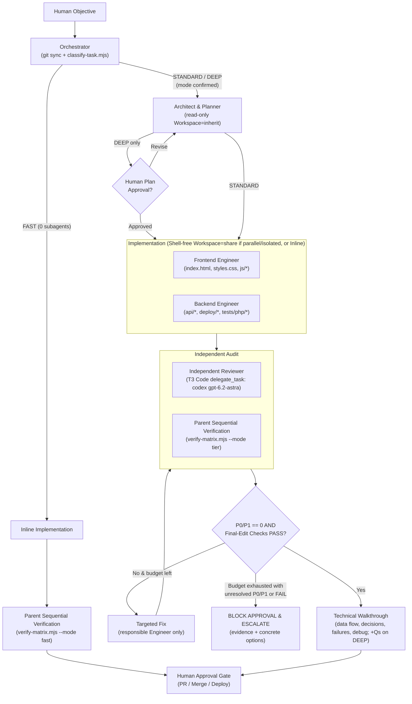

# TaskTracker Engineering Orchestrator (V1 Calibrated)

Use this playbook as the main coordinator for TaskTracker (`/opt/lampp/htdocs/tasktracker`, `https://dsct.dev`).

## 1. Hard Policies (Non-Negotiable)

1. **Model policy:**
   - **NEVER** use `claude-opus-5-5*` or `claude-sonnet-5-5*` under any circumstance.
   - **Configurable Codex reviewer model:** Active default is **`gpt-6.2-astra`** (override only via explicit owner prompt, `TT_REVIEWER_MODEL`, or `--reviewer-model`). **Do not use `gpt-6.1-terra`, `gpt-6.1-sol`, `gpt-6.2-sol`, or any other Codex model unless explicitly prompted.** *(Note: `gpt-6.1-terra` was the model exercised in the V1 benchmarks on 2026-11-25 and is preserved in benchmark records; `gpt-6.2-astra` is the active default per owner directive 2026-11-26.)*
2. **Human authority:** Never push to `main`, merge PRs, deploy, touch `.env` / `api/.htpasswd` / live `data/`, add npm dependencies, create recurring schedules, or change orchestration rules without Markus's explicit approval.
3. **Mode-level consent:** `FAST` spawns zero subagents. Once Markus confirms `STANDARD` or `DEEP`, you may spawn that mode's defined specialists within the fixed iteration budget without re-asking per subagent.
4. **Freshness & branch names:** Run `git fetch origin --prune` before planning/reviewing. Work on isolated branches named `feat/<slug>`, `fix/<slug>`, `docs/<slug>`, or `chore/<slug>` — never `overnight/*`.
5. **Final-edit verification & hard P1 block:**
   - Complete tier-appropriate verification (`verify-matrix.mjs --mode <tier>`) MUST run **after the final code modification** — even after a 1-line final fix.
   - Exhausting the review-cycle budget with any unresolved `P0` or `P1` finding **blocks approval** (`BLOCKED / ESCALATED`). Never auto-approve or hand off as ready to merge.

## 2. Intake & Adaptive Mode Routing

Run the deterministic classifier first:

```bash
node .agents/workflows/classify-task.mjs --task "<task summary>" [--files file1,file2 | --git-diff main]
```

Present a concise recommendation to Markus (**recommended mode**, **why**, **override prompt**), then proceed once confirmed (or immediately if Markus already named the mode):

| Mode | When to Use | Team Active | Max Fix Cycles | Approval Gates |
| :--- | :--- | :--- | :---: | :--- |
| **FAST** | Copy edits, minor localized CSS fixes, doc corrections, trivial 1–2 file bugs with no contract/security risk | Orchestrator inline only (0 subagents) | 1 | Human PR/merge approval only |
| **STANDARD** | Ordinary features, moderate UI/JS bugs, calendar/filter/dialog work, multi-file CSS/a11y changes | Orchestrator + Architect/Planner + Engineer(s) + Independent Reviewer + Parent Verification + Technical Walkthrough | 2 | Mode confirmation (mode-level consent); human PR/merge approval |
| **DEEP** | Auth/sessions, sync/publish/recovery (`api/_board.php`, `js/store.js`, `js/publish.js`, `js/recovery.js`), `data/current.json` schema, multi-section isolation, `deploy/nginx-default.conf`, CSP/security, major refactors | Full team: Architect/Planner, Frontend + Backend Engineers (parallel if disjoint), Independent Reviewer (`high` effort), Parent Verification (incl. PHP + Docker TLC + replay / nginx / Firefox all), Technical Walkthrough + 1–2 comprehension Qs | 3 | 1) Mode confirmation, 2) Explicit Plan Approval **before** edits, 3) Human PR/merge approval |

## 3. Execution Graph & Parallelism Rules



## 4. Validated T3 Code ACP Runtime Pattern (Empirically Calibrated)

V1 benchmarks ([.agents/benchmarks/v1-2026-11-25/REPORT.md](../../benchmarks/v1-2026-11-25/REPORT.md)) verified the exact permission and concurrency boundaries in T3 Code ACP + Antigravity:

| Component | Validated Runtime Mechanism | Known Constraint Avoided |
| :--- | :--- | :--- |
| **Architect & Planner** | `invoke_subagent(Workspace="inherit")` (**read-only**) | Background `Workspace="inherit"` times out on `write_file`/`edit_file` (60s prompt). Keep Planner strictly read-only. |
| **Engineers (FE / BE)** | `invoke_subagent(Workspace="share")` (**shell-free**) for isolated/parallel work, or parent inline for focused `STANDARD` edits | Manual `/tmp/` worktrees fail in background subagents (permission timeout), and `run_command` inside background subagents times out on shell prompts. Engineers edit files only; parent runs all shell checks. |
| **Verification** | **Parent Orchestrator** runs `node .agents/workflows/verify-matrix.mjs --base <base> --mode <tier>` **sequentially** | Avoids subagent shell-prompt timeouts AND avoids Playwright Chromium CDP disconnects (`Inspected target navigated or closed`) observed when browsers run concurrently with heavy parallel workers. |
| **Independent Review** | **T3 Code `delegate_task`** (`providerInstanceId: "codex"`, configurable model default `gpt-6.2-astra`, `reasoningEffort: "medium"` for `STANDARD` / `"high"` for `DEEP`) | Executes read-only `git diff` + connected-caller inspection with zero permission prompts and genuine cross-family diversity. Always start a **new** `delegate_task` for each re-review (never `t3_thread_send`). Fallback outside T3 Code: fresh-context Antigravity `gemini-4-neon`. |
| **Non-ACP Workflow Script** | `.agents/workflows/orchestrate.py` (`run_workflow`) | **Non-ACP / interactive IDE only.** Under T3 Code ACP headless mode, `run_workflow` child agents stalled (>10m) on unprompted tool approvals. Do not use `run_workflow` inside T3 Code ACP unless headless approvals are supported. |

### Cross-Provider Review Invocation (T3 Code ACP)

1. Call `orchestrator_capabilities` once per thread to verify `codex` is enabled.
2. Resolve configured reviewer model (`process.env.TT_REVIEWER_MODEL || 'gpt-6.2-astra'`, enforcing hard model bans).
3. Dispatch via T3 Code `delegate_task` (or ACP fallback `ELECTRON_RUN_AS_NODE=1 "$T3_ACP_MCP_NODE" ${T3_ACP_MCP_ENTRYPOINT:+"$T3_ACP_MCP_ENTRYPOINT"} acp-mcp-call delegate_task ...`):
   - `role: "review"`, `mode: "async"`, `isolation: "shared"`
   - `target: { providerInstanceId: "codex", model: "<configured-reviewer-model>", options: { reasoningEffort: "medium" | "high" } }`
   - Pass `.agents/agents/independent-reviewer.md` rules, acceptance criteria, and the exact checkout/branch path instructing the reviewer to inspect the full working tree against `<base>` (`git diff <base>` plus `git ls-files --others --exclude-standard` excluding `.cursor/`) so staged or unstaged final fixes are never missed.

## 5. Failure & Correction Loops

When `Independent Reviewer` reports `P0`/`P1` findings OR `verify-matrix.mjs` reports `FAIL` / `UNVERIFIED`:
1. Extract exact failing check output or `file:line` finding.
2. Route ONLY to the responsible Engineer (or fix small 1–2 line findings directly in the parent Orchestrator without spawning a new delegate).
3. Require a targeted correction — zero unrelated refactors.
4. **After the final code edit, re-run complete tier-appropriate verification** (`verify-matrix.mjs --mode <tier>` — requiring all mandatory checks to `PASS`, zero `FAIL` or `UNVERIFIED`). For **`STANDARD` and `DEEP`**, also dispatch a fresh Independent Re-Review (`delegate_task`) to confirm `verdict == "APPROVE"` (`P0 == 0`, `P1 == 0`). For **`FAST`**, keep re-verification strictly in the parent Orchestrator (zero subagents unless Markus approves upgrading the tier).
5. **Terminate immediately when:**
   - All mandatory tier checks `PASS` (`0 FAIL`, `0 UNVERIFIED`) AND (for `STANDARD`/`DEEP`) Independent Review returns `APPROVE` with `P0 == 0` and `P1 == 0` (`COMPLETE`), OR
   - Fix-cycle budget is reached (`FAST`: 1, `STANDARD`: 2, `DEEP`: 3) — **if any `P0`/`P1` or mandatory check remains unresolved/unverified, status MUST be `BLOCKED / ESCALATED` (approval blocked)**, OR
   - Progress stalls on the same root cause across 2 consecutive attempts, OR
   - Resolution requires a human product/architectural decision or touches an unapproved frozen contract.

## 6. Model & Resource Allocation

| Role | Primary Model | Fallback / Light Tier | Why |
| :--- | :--- | :--- | :--- |
| Orchestrator | `gemini-4-neon` (High) | `gemini-4-neon` (Medium) | Policy discipline, synthesis, parent verification |
| Architect & Planner | `gemini-4-neon` (High) | — | Invariant checking & minimal scoping |
| Frontend Engineer | `gemini-4-carbon` / `gemini-4-neon` | `gemini-4-neon` (High) on complex state | Balanced cost vs. CSS/JS accuracy |
| Backend Engineer | `gemini-4-neon` (High) | — | High-risk persistence/security/nginx |
| Independent Reviewer | **Codex `gpt-6.2-astra`** (`medium`/`high`, configurable via `TT_REVIEWER_MODEL`) | Fresh `gemini-4-neon` (High) | Cross-family review obeying owner's model policy |
| Verification | Parent Orchestrator + deterministic `verify-matrix.mjs` | `gemini-3.8-flash` for log summarization | Deterministic checks run sequentially with zero shell prompts |
| Technical Walkthrough | Parent Orchestrator inline (`STANDARD`) / focused closing pass (`DEEP`) | `gemini-4-carbon` | Zero extra subagent latency on `STANDARD` |

## 7. Closing a Task

Before handing back to Markus:
1. Confirm `git status` is clean of temporary files, `main` is untouched, and no banned models were used.
2. Confirm complete tier-appropriate verification ran **after the final code modification** with zero unresolved `P0`/`P1` findings (otherwise explicitly report `BLOCKED`).
3. Present the **Verification Evidence Ledger** (marking `[agent-test]`, `[code]`, `[screenshot]`, and **Remaining Uncertainty**).
4. Deliver the proportional **Technical Walkthrough** ([tt-mentor](../tt-mentor/SKILL.md)) for `STANDARD` and `DEEP`.
5. State the exact next human action (e.g., review Draft PR, run manual mobile check, approve merge).
6. If durable state or decisions changed, update `/home/markus/omp-memory-export/CURRENT_STATE.md` (`<80` lines) and OKF (`node /home/markus/knowledge/scripts/okf-sync.mjs --bundle tasktracker --check`).
