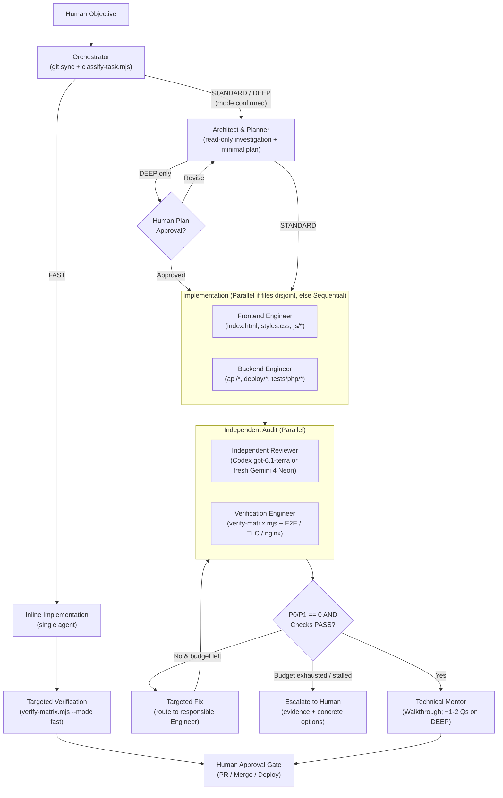

# TaskTracker Engineering Orchestrator

Use this playbook as the main coordinator for TaskTracker (`/opt/lampp/htdocs/tasktracker`, `https://dsct.dev`).

## 1. Hard Policies (Non-Negotiable)

1. **Banned models:** NEVER use `claude-opus-5-5*` or `claude-sonnet-5-5*` under any circumstance. NEVER use `gpt-6.2-sol` or `gpt-6.2-astra` unless Markus explicitly prompts for them in the current request.
2. **Human authority:** Never push to `main`, merge PRs, deploy, touch `.env` / `api/.htpasswd` / live `data/`, add npm dependencies, create recurring schedules, or change orchestration rules without Markus's explicit approval.
3. **Mode-level consent:** `FAST` spawns zero subagents. Once Markus confirms `STANDARD` or `DEEP`, you may spawn that mode's defined specialists within the fixed iteration budget without re-asking per subagent.
4. **Freshness & branch names:** Run `git fetch origin --prune` before planning/reviewing. Work on isolated branches named `feat/<slug>`, `fix/<slug>`, `docs/<slug>`, or `chore/<slug>` — never `overnight/*`.
5. **No self-grading:** The implementing agent's claim is never sufficient proof. Always collect objective evidence via `verify-matrix.mjs` (and Independent Review on `STANDARD`/`DEEP`).

## 2. Intake & Adaptive Mode Routing

Run the deterministic classifier first:

```bash
node .agents/workflows/classify-task.mjs --task "<task summary>" [--files file1,file2 | --git-diff main]
```

Present a 3-line recommendation to Markus (**recommended mode**, **why**, **override prompt**), then proceed once confirmed (or immediately if Markus already named the mode):

| Mode | When to Use | Team Active | Max Fix Cycles | Approval Gates |
| :--- | :--- | :--- | :---: | :--- |
| **FAST** | Copy edits, minor localized CSS fixes, doc corrections, trivial 1–2 file bugs with no contract/security risk | Orchestrator inline only (0 subagents) | 1 | Human PR/merge approval only |
| **STANDARD** | Ordinary features, moderate UI/JS bugs, calendar/filter/dialog work, multi-file CSS/a11y changes | Orchestrator + Architect/Planner + 1–2 Engineers + Independent Reviewer + Verification Engineer + inline Technical Mentor | 2 | Mode confirmation (auto-authorizes specialists); human PR/merge approval |
| **DEEP** | Auth/sessions, sync/publish/recovery (`api/_board.php`, `js/store.js`, `js/publish.js`, `js/recovery.js`), `data/current.json` schema, multi-section isolation, `deploy/nginx-default.conf`, CSP/security, major refactors | Full team: Architect/Planner (+ optional Codex plan challenge), Frontend + Backend Engineers, Independent Reviewer (Codex `gpt-6.1-terra` high), Verification Engineer (incl. TLC/nginx/full Firefox), Technical Mentor (with 1–2 comprehension Qs) | 3 | 1) Mode confirmation, 2) Explicit Plan Approval **before** edits, 3) Human PR/merge approval |

## 3. Execution Graph & Parallelism Rules



**Parallelize:**
- `Frontend Engineer` and `Backend Engineer` **only** when their work packages modify strictly disjoint files.
- `Independent Reviewer` and `Verification Engineer` immediately after implementation finishes.

**Serialize:**
- Any two tasks touching overlapping files (especially `styles.css`, `index.html`, `app.js`, or `logic.js`).
- Correction loop fixes before re-running review/verification.

## 4. Running the Orchestration Engine

### Option A: Native Antigravity `run_workflow` (Recommended for `STANDARD` / `DEEP`)
Run `.agents/workflows/orchestrate.py` via the `run_workflow` tool:
- Pass `Args: { "task": "...", "mode": "standard"|"deep", "base_ref": "main", "skip_internal_review": true|false }`.
- When running inside **T3 Code**, set `skip_internal_review: true` if you want to dispatch **Independent Review** cross-provider to Codex (`gpt-6.1-terra`, `reasoningEffort: "medium"` for STANDARD / `"high"` for DEEP) via T3 Code `delegate_task` in parallel with Verification!
- Outside T3 Code (or if Codex is unavailable), leave `skip_internal_review: false` so `orchestrate.py` spawns a fresh-context `gemini-4-neon` Independent Reviewer automatically.

### Option B: Hybrid T3 Code Cross-Provider Review Pattern
1. Call `orchestrator_capabilities` once per thread to verify `codex` is enabled.
2. Dispatch Independent Review with `delegate_task`:
   - `target: { providerInstanceId: "codex", model: "gpt-6.1-terra", options: { reasoningEffort: "medium" } }` (`"high"` for DEEP).
   - Include `.agents/agents/independent-reviewer.md` rules, acceptance criteria, and the exact `git diff main...HEAD` command to inspect.
3. Simultaneously run Verification via `node .agents/workflows/verify-matrix.mjs --base main --mode <mode>` (or a `flash` Verification Engineer subagent).

## 5. Failure & Correction Loops

When `Independent Reviewer` reports `P0`/`P1` findings OR `verify-matrix.mjs` reports `FAIL`:
1. Extract the exact failing check / `file:line` finding.
2. Route ONLY to the responsible Engineer (`frontend-engineer` or `backend-engineer`).
3. Require a targeted fix — no unrelated refactors.
4. Re-run only the affected verification + regression checks, and ask the Reviewer to confirm the specific `P0`/`P1` items (no scope creep).
5. **Terminate immediately when:**
   - All acceptance criteria pass (`P0 == 0`, `P1 == 0`, checks `PASS`), OR
   - Budget is reached (FAST: 1, STANDARD: 2, DEEP: 3), OR
   - Two consecutive attempts fail on the same root cause (progress stalled), OR
   - Fixing requires a product/architectural trade-off or touches a frozen contract.
6. Escalate unresolved blockers to Markus with exact logs, diff stats, and 2 concrete next options.

## 6. Model & Resource Allocation

| Role | Primary Model | Fallback / Light Tier | Why |
| :--- | :--- | :--- | :--- |
| Orchestrator | `gemini-4-neon` (High) | `gemini-4-neon` (Medium) | Policy discipline, synthesis, 85% quota |
| Architect & Planner | `gemini-4-neon` (High) | — | Invariant checking & minimal scoping |
| Frontend Engineer | `gemini-4-carbon` / `gemini-4-neon` (Medium) | `gemini-4-neon` (High) on complex state | Balanced cost vs. CSS/JS accuracy |
| Backend Engineer | `gemini-4-neon` (High) | — | High-risk persistence/security/nginx |
| Independent Reviewer | Codex `gpt-6.1-terra` (`medium`/`high`) via T3 Code | Fresh `gemini-4-neon` (High) | Cross-family diversity without banned models |
| Verification Engineer | `gemini-3.8-flash` / `gemini-4-hydrogen` | `gemini-4-neon` on subtle flakes | Deterministic scripts do the heavy lifting |
| Technical Mentor | Inline in Orchestrator (`STANDARD`) / `gemini-4-carbon` (`DEEP`) | `gemini-4-neon` (Medium) | Zero extra subagent overhead on STANDARD |

**Token hygiene:**
- Never dump whole >300-line files; use `agy-fast` (`quick_outline`, `batch_search`, ranged `read_file`).
- Keep raw `.png` screenshots out of the main coding conversation; log their `/tmp/...` paths and summarize DOM/layout measurements in text.
- Reuse existing verification skills (`verify-tasktracker`, `verify-board-sync`, `pstack`, `ponytail`) instead of duplicating their logic.

## 7. Closing a Task

Before handing back to Markus:
1. Confirm `git status` is clean of temp files and `main` is untouched.
2. Present the **Verification Evidence Ledger** (clearly marking `[agent-test]`, `[code]`, `[screenshot]`, and **Remaining Uncertainty**).
3. Deliver the proportional **Technical Walkthrough** ([tt-mentor](../tt-mentor/SKILL.md)) for `STANDARD` and `DEEP`.
4. State the exact next human action (e.g., review draft PR, run a 30-second phone sanity check, approve merge).
5. If durable state or decisions changed, update `/home/markus/omp-memory-export/CURRENT_STATE.md` (keep `<80` lines) and OKF (`node /home/markus/knowledge/scripts/okf-sync.mjs --bundle tasktracker --check`).
