# TaskTracker

A shared task board for a school class. The class president posts what the section has to do, and each classmate keeps their own progress on it, privately, in their own browser.


**Live site:** https://dsct.dev

<table>
  <tr>
    <td></td>
    <td></td>
  </tr>
  <tr>
    <td></td>
    <td></td>
  </tr>
</table>

## Why this exists

I am the class president of my section. Deadlines, quizzes, summative tests, term exams, rubrics and submission links were scattered across group chats, and people kept asking the same questions. TaskTracker puts it all in one place: I publish a task once, and everyone can see what is due, when, and what they still need to do.

It is also a project for my computer science studies, so the design choices below matter as much as the features.

## Features

**For classmates**
- A board of published tasks, as a Kanban board or a list, sorted by due date with overdue tasks first.
- Set your own status on each task: Not started, In progress, or Done. Drag cards, or use the dropdown.
- Completed tasks move to their own page and can be reopened at any time.
- Month and week calendar views. On phones the month shows coloured dots with the selected day's tasks listed underneath, and the week is one row per day.
- Task notes with bold, italic, bullets, clickable links and images.
- Open PDF, PPTX, DOCX, JPG and PNG files attached to a task.
- Announcements pinned by the president.
- Dark and light themes, a first-time tutorial, and quick-add shortcuts such as `tmr`, `3pm` and `ip`.
- Transfer your progress to another device with a QR code or a link.

**For the president**
- A private admin area to draft tasks and announcements, preview them as a student would see them, and publish.
- Attach files to a task with a button, by pasting, or by dropping them in. Pasted images are compressed in the browser first.
- A version history of every publish, so a mistake can be undone.
- A diff of what changed since the last publish.

## How it works

Progress is personal and stays on the device. Tasks are shared and come from the server.

<picture>
  <source media="(prefers-color-scheme: dark)" srcset="docs/architecture-dark.svg">
  
</picture>

- **Draft and Board.** The president edits a private Draft. Publishing replaces the public Board with it. Students only ever see the Board.
- **Status stays local.** Each classmate's progress is saved in their own browser and is never sent to the server, so the president cannot see who has done what.
- **Transfer** moves progress between devices. Each task keeps the time its status last changed, and when two devices disagree, the most recent change wins.

## Tech stack

| Area | Choice |
| --- | --- |
| Front end | Plain HTML, CSS and JavaScript. No framework, no build step. |
| Back end | PHP 8.1 or newer, with flat JSON files for storage. No database. |
| Hosting | Azure App Service (Linux, PHP 8.5, nginx) |
| Deploys | GitHub Actions |
| Fonts | IBM Plex Sans and IBM Plex Mono |

## Data and privacy

- There are no accounts and no sign-up. Classmates' progress, theme and view choices live in the browser's local storage.
- Clearing a browser's site data removes that progress. Use Transfer to move it or keep a copy.
- Transfer creates a temporary file on the server that expires after 10 minutes and can be cancelled early. It contains task ids, statuses and timestamps only.
- The server never receives classmates' statuses unless they choose to transfer them.
- Attached files can be opened by anyone who has the exact link, even before the task is published. The names are random and cannot be guessed.

## Security notes

- Admin sign-in uses HTTP Basic Authentication on one endpoint only, `api/login.php`, enforced by nginx. A successful sign-in sets an HttpOnly, SameSite=Lax session cookie. The server stores only a hash of the session token, and sessions expire after 60 days of inactivity. Every other admin endpoint checks that cookie and answers 401 without a browser password prompt. `api/logout.php` revokes the session.
- Publishing is validated on the server: field types and lengths, date and time formats, a maximum board size, and a rule that refuses to publish an empty board unless the president explicitly confirms clearing it.
- Writes are serialized with a lock and replaced atomically, so a failed publish never leaves a half-written board.
- Notes and announcements are sanitized to a small whitelist of tags before they are shown.
- Uploads are admin only, limited to pdf, pptx, docx, jpg and png, checked by file content and not just the name, size limited, and stored under random names. Word and PowerPoint files always download.
- Transfer endpoints rebuild every payload from a strict whitelist and are rate limited per IP address.
- Secret files, the `data/` folder and the `deploy/` folder are never served to the public. Only `data/current.json` is.

## Getting started locally

You need PHP 8.1 or newer, for example through XAMPP.

1. Clone the repository into your web root (for XAMPP, `htdocs`).
2. Start Apache and open `http://localhost/TaskTracker/`.
3. Make sure the `data/` folder can be written by PHP. It is created on first use.
4. To try the admin area, add `?admin` to the address. Signing in goes through `api/login.php`, which needs `REMOTE_USER` to be set by the web server. Locally, protect that one file with an `.htaccess` and `.htpasswd` of your own. They are not in this repository.

`api/config.php` is optional. If it is missing, defaults are used.

## Deployment

The production site runs on Azure App Service with GitHub Actions.

- Pushing to `main` deploys the code. `data/` is created on the server and is not in git.
- Azure's PHP images use nginx, which ignores `.htaccess`. The equivalent rules, including the password on `api/login.php`, the exact list of public API routes, and blocking of hidden files and `data/`, are in [`deploy/nginx-default.conf`](deploy/nginx-default.conf).
- [`deploy/startup.sh`](deploy/startup.sh) copies that config into place at startup, so the rules are re-applied after every restart. Set the app's Startup Command to `/home/site/wwwroot/deploy/startup.sh`. If the file is missing or the new config fails `nginx -t`, the previous config stays, which on Azure means the default config without the TaskTracker rules. The script then prints a banner to the startup log and writes `/home/LogFiles/startup-nginx-error.txt`, so check there if sign-in stops working after a restart.
- [`deploy/check-nginx.sh`](deploy/check-nginx.sh) runs `nginx -t` on the config without root. A GitHub Actions workflow runs it on pull requests, and the deploy job runs it before uploading, so an invalid config never ships. Regexes containing `{32}` must be quoted in nginx, or it reads the brace as a block.
- The deploy stamps `styles.css`, `app.js`, `logic.js`, `qr-draw.js` and `attachments.js` in `index.html` with the commit, so a reload after an update always gets the new files. Stamped files are cached for a year; the page itself and `qrcode.js` are revalidated.
- [`deploy/php-uploads.ini`](deploy/php-uploads.ini) raises PHP's upload limits at startup. `deploy/startup.sh` installs it, so the app needs a restart after this change.
- With XAMPP, serve uploads by adding `Alias /TaskTracker/uploads "C:/xampp/htdocs/TaskTracker/data/uploads"` to Apache.
- The admin password file is created once on the server, outside the web folder, and is never committed.
- HTTPS Only is turned on.

## Project structure

```
index.html        Markup for every page and dialog, plus the icon sprite
styles.css        Design tokens, layout and both themes
app.js            Application behavior: pages, dialogs, rendering, publishing
logic.js          Pure logic (dates, Task model, sorting, progress merge, quick-add parsing)
attachments.js    File picker, image compression and upload
qr-draw.js        Draws the transfer QR code
qrcode.js         QR code generator library
transfer.php      Temporary transfer links
api/login.php     Admin sign-in (the only Basic Auth endpoint), starts a session
api/logout.php    Ends the session
api/_session.php  Session helpers shared by the admin endpoints
api/publish.php   Publish the Board (admin session)
api/upload.php    Receive an uploaded file (admin session)
api/versions.php  Version history (admin session)
deploy/           nginx rules, startup script, config check and PHP upload limits
docs/             Architecture diagram and screenshots
data/             Created at runtime, not in git: board, versions, sessions, uploads
```

## Testing

I test by hand with a checklist: both themes, collapsed and open sidebar, a 320 px wide screen, touch targets on phones, keyboard-only use, and admin and student sessions. Automated tests for the core logic (merging, sorting, due dates and the sanitizers) are on the roadmap.

## Known limitations

- Uploaded files are never deleted automatically, because older saved versions may still point to them. Cleanup of unused files is planned.
- Images pasted into notes before this change are still stored inside the note.
- Progress lives in the browser, so it does not follow a person to a new device without Transfer.
- An already-open tab keeps running the old files until it is reloaded. A normal reload fetches the latest ones.

## Roadmap

- [x] Phone calendar readability
- [x] Add to home screen on iPhone
- [ ] Update notice: a popup listing tasks that are new or changed since your last visit
- [ ] Manage subjects from the admin area
- [x] File uploads for PDFs and images on tasks
- [ ] Clean up unused uploaded files
- [ ] Automatic cleanup of progress for deleted tasks
- [ ] Optional personal to-do list, kept on the device
- [ ] CSV export and progress charts
- [ ] Automated tests for the core logic
- [ ] Longer term: reminders and insights, designed with privacy first

## Credits and license

Released under the [MIT License](LICENSE).

- Fonts: [IBM Plex](https://github.com/IBM/plex), SIL Open Font License.
- QR generation: `qrcode.js`, which bundles [qrcode-generator](https://github.com/kazuhikoarase/qrcode-generator) by Kazuhiko Arase, MIT License.

Built by [@shaivsaga](https://github.com/shaivsaga).